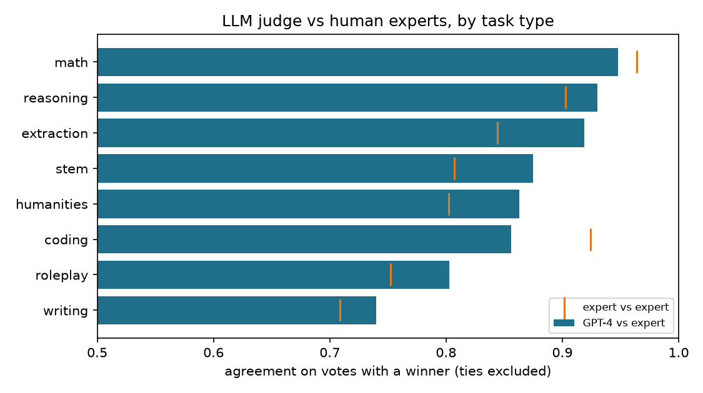
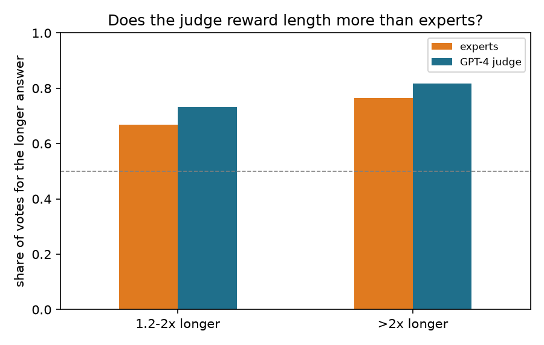

# Who judges the judge? Checking an LLM judge against human experts

Many teams let a strong LLM grade the outputs of their AI products. Before trusting it, I wanted to
check three things on public data: **does the judge agree with human experts as often as experts agree
with each other, is that true for every type of task, and does it reward longer answers?**

## Results

Data: 3,355 pairwise votes by 65 human experts and 2,400 GPT-4 votes on the same answers
(MT-Bench, 80 questions in 8 categories, 6 models).

| | pairs of votes | agreement (ties excluded) | agreement (ties included) | Cohen's kappa |
|---|---|---|---|---|
| expert vs expert | 2,367 | 0.827 | 0.655 | 0.47 |
| GPT-4 vs expert | 3,355 | 0.856 | 0.662 | 0.48 |

1. **Overall, the GPT-4 judge agrees with experts about as often as experts agree with each other.**
   This reproduces the main result of the MT-Bench paper (Zheng et al., 2023); my numbers are close
   to theirs but not identical because I count every pair of votes on the same item.
2. **The average hides differences by task type.** Agreement goes from 0.74 on *writing* to 0.95 on
   *math*. In *coding* the judge agrees with experts less often (0.86) than experts agree with each
   other (0.92), while in open-ended categories (writing, roleplay, humanities) experts themselves
   disagree more and the judge sits slightly above their baseline. With 150-350 vote pairs per
   category, differences of a few points are a signal to check, not a proven effect.
3. **The judge picks the longer answer slightly more often than experts on the same items**: 73% vs 67%
   when one answer is 1.2-2x longer, 82% vs 77% when it is more than 2x longer.

4. **Clear mistakes are rare.** On 485 items where at least two experts all picked the same winner,
   GPT-4 picked the other answer 22 times (4.5%), most often in *writing* (7) and *roleplay* (4).
   In these 22 cases GPT-4 chose the longer answer only 32% of the time, so these errors are not
   explained by length. The cases are in `results/disagreements.csv`, with an empty column for notes.

**What I take from it:** an LLM judge is a reasonable first filter, but the agreement should be
measured per task type against a human baseline, and length should be checked as a possible bias,
before letting it replace human review.

## Method

- Every vote says which of two answers is better (A, B or tie). The two models of each comparison are
  put in alphabetical order first, otherwise the same opinion seen as (A vs B) and (B vs A) would count
  as a disagreement.
- **Baseline:** agreement between two different experts on the same item. A judge cannot be expected
  to agree with humans more than humans agree with each other.
- Agreement is reported with ties excluded (both sides picked a winner) and included, plus Cohen's
  kappa, which corrects for agreement expected by chance.
- **Length check:** only items where one answer is at least 20% longer and that were voted by both
  GPT-4 and experts, so both are compared on exactly the same answers.

## Data and licence

- [MT-Bench human judgments](https://huggingface.co/datasets/lmsys/mt_bench_human_judgments) – LMSYS,
  CC BY 4.0. Paper: Zheng et al., *Judging LLM-as-a-Judge with MT-Bench and Chatbot Arena*, NeurIPS 2023.
- MT-Bench questions and categories – [FastChat](https://github.com/lm-sys/FastChat), Apache-2.0.

The data is not stored in this repository: the notebook downloads it (pinned versions).

## Limits

- The judge is GPT-4 as it was in 2023 and the answers come from 2023 models; newer judges may behave
  differently. The method stays the same.
- I did not run a judge myself: GPT-4's votes come from the dataset.
- Per-category numbers rest on 150-350 vote pairs each, so small differences are uncertain.
- Answer length is measured in characters, a rough proxy for verbosity.

## How to run

Everything is in one notebook, `who_judges_the_judge.ipynb`. Open it in Google Colab
(*File → Open notebook → GitHub*, paste the repository link) and choose *Runtime → Run all*: it
downloads the data, runs the analysis and shows the figures in a few seconds, no GPU needed.

To run it locally: `pip install -r requirements.txt jupyter`, then open the notebook.
Results go to `results/`, figures to `figures/`.
